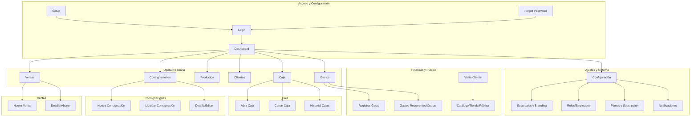

# Documentación del Sistema POS & Consignaciones

Este documento detalla la funcionalidad principal del sistema, su arquitectura de datos y la estructura de rutas (Frontend y API).

## 🚀 Funcionalidad Principal

El sistema es una solución integral para la gestión de puntos de venta (POS) con un fuerte enfoque en el modelo de **Consignaciones**, permitiendo a los comerciantes gestionar mercadería entregada a terceros sin venta inmediata.

### 📦 Gestión de Inventario
- **Multisucursal**: El stock se gestiona de forma aislada por sucursal.
- **Vencimientos**: Control y alertas automáticas de productos próximos a vencer.
- **Categorización**: Organización de productos por categorías con códigos de colores.
- **Movimientos de Stock**: Registro histórico de entradas, salidas, ajustes, roturas y transferencias.

### 💰 Punto de Venta (POS) y Caja
- **Ventas Rápidas**: Interfaz para ventas "casuales" con lectura de código de barras.
- **Control de Caja**: Sesiones de caja con apertura, movimientos (ingresos/egresos) y cierre con auditoría de diferencias.
- **Metodos de Pago**: Soporte para Efectivo, Transferencia, Tarjeta y otros.

### 📑 Consignaciones
- **Flujo Completo**: Creación de remitos, seguimiento de unidades "en la calle" y liquidación parcial o total.
- **Liquidaciones**: Proceso donde se transforma la mercadería consignada en una venta real, actualizando saldos de clientes.
- **Remitos Digitales**: Generación de links compartibles para que los clientes vean sus remitos de entrega.

### 👥 Clientes y Cuentas Corrientes
- **Saldo deudor**: Seguimiento de deuda por cliente.
- **Pagos y Recibos**: Registro de pagos a cuenta para reducir saldos.

### 📊 Gastos y Finanzas
- **Registro de Egresos**: Gestión de pagos con subida de comprobantes opcional.
- **Gastos Recurrentes**: Creación de cuotas o gastos automáticos (frecuencia semanal, mensual o anual).
- **Categorización**: Distribución de gastos en categorías por cada sucursal.

### 🌐 Catálogo Público y Enlaces
- **Vista al Público**: Los comercios pueden activar una URL pública para mostrar su inventario.
- **Personalización de Marca**: Elección de colores, logo, banner promocional y layout de artículos (`Branding`).
- **Enlaces Compartibles (`ShareLink`)**: Generación de URLs de acceso público, temporal y con conteo de vistas, para enviar remitos y tickets al cliente (sin que necesite clave).

### � Notificaciones y SAAS (Suscripciones)
- **Monetización**: Sistema de planes (`Plan`, `Promocode`) integrados con MercadoPago y PayPal para cobro de licencias recurrentes a las sucursales.
- **Central de Alertas**: Avisos en tiempo real sobre límites de stock, vencimientos de productos, pagos recibidos y alertas de consignaciones (`Notification`).

---

## �🗺️ Mapa de Rutas (Diagrama)

---

## 🛠️ Detalle de Rutas

### Frontend (User Interface)

| Ruta | Función |
| :--- | :--- |
| `/dashboard` | Resumen de KPI, ventas hoy, stock bajo y gráficos. |
| `/ventas/nueva` | Terminal de venta con carrito y selección de cliente. |
| `/consignaciones/nueva` | Formulario para entregar mercadería en consignación. |
| `/consignaciones/[id]/liquidar` | Interfaz para reportar qué se vendió de una consignación. |
| `/caja/abrir` | Inicio de jornada laboral con monto inicial. |
| `/productos` | Listado, filtros por categoría y gestión de stock. |
| `/clientes` | Gestión de base de datos de clientes y saldos. |
| `/gastos` | Seguimiento de egresos, categorías de gastos y cuotas recurrentes. |
| `/settings/*` | Ajustes de la cuenta: sucursales, facturación, interfaz y tienda. |
| `/lista / /ver/[id]` | Catálogo público (Tienda) abierto a los visitantes externos. |

### API (Backend)

| Prefijo | Funcionalidad |
| :--- | :--- |
| `/api/auth/*` | Autenticación, sesiones y recuperación de clave. |
| `/api/ventas` | Registro de transacciones y generación de tickets. |
| `/api/consignaciones` | Lógica de entrega, remitos y seguimiento. |
| `/api/liquidaciones` | Cierre de consignaciones y generación de ventas vinculadas. |
| `/api/productos` | CRUD de productos y búsqueda por código de barras. |
| `/api/clientes` | Datos de cliente y estado de cuenta corriente. |
| `/api/gastos` | CRUD de gastos en caja y manejo masivo de cuotas recurrentes. |
| `/api/public` | Accesos anónimos para el catálogo e inventario. |
| `/api/notificaciones` | Endpoints de alertas, lectura y eliminación. |
| `/api/subscriptions` | Gestión de planes, Checkout Pro y estado de la cuenta SAAS. |
| `/api/webhooks/*` | Recepción de notificaciones de pago (MercadoPago/PayPal). |
| `/api/historial` | Extracción de reportes de logs, cajas o auditoría. |
| `/api/cron/*` | Tareas automáticas (check vencimientos, stock, suscripciones). |

---

## 🗄️ Modelo de Datos (Resumen)

El sistema utiliza **Prisma ORM** con una base de datos **PostgreSQL**. Las entidades principales son:

- **Usuario / HorarioLaboral**: Autenticación, roles (ADMIN/EMPLEADO) y turnos.
- **Sucursal / Branding**: Eje de la organización de datos de sistema multi-tenant, incluye colores y logotipo.
- **Producto / StockSucursal**: Inventario desacoplado por local, soportando stock principal vs stock consignado.
- **Consignacion / Liquidacion**: Motor iterativo para enviar mercadería temporal y cobrarla a medida que decae.
- **SesionCaja / MovimientoCaja**: Trazabilidad de dinero y caja fuerte.
- **Gasto / CategoriaGasto**: Control de finanzas y sistema de pagos que requieren cobros en plazos (recurrentes).
- **Subscription / Plan / PromoCode**: Monetización, integraciones de cobro de membresías comerciales y límites de uso.
- **Notification / ShareLink**: Sistema de alertas nativas de la aplicación y generación ágil de visores para tickets/pedidos.

