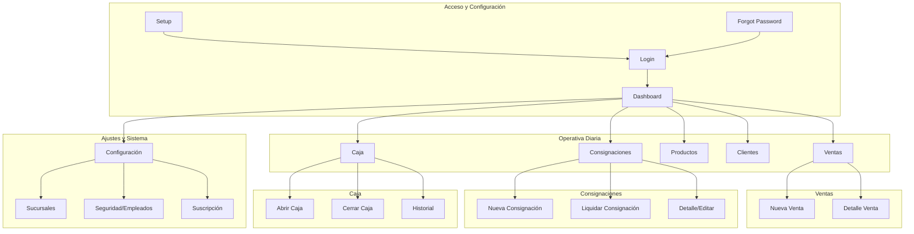

# Documentación del Sistema POS & Consignaciones

Este documento detalla la funcionalidad principal del sistema, su arquitectura de datos y la estructura de rutas (Frontend y API).

## 🚀 Funcionalidad Principal

El sistema es una solución integral para la gestión de puntos de venta (POS) con un fuerte enfoque en el modelo de **Consignaciones**, permitiendo a los comerciantes gestionar mercadería entregada a terceros sin venta inmediata.

### 📦 Gestión de Inventario
- **Multisucursal**: El stock se gestiona de forma aislada por sucursal.
- **Vencimientos**: Control y alertas automáticas de productos próximos a vencer.
- **Categorización**: Organización de productos por categorías con códigos de colores.
- **Movimientos de Stock**: Registro histórico de entradas, salidas, ajustes, roturas y transferencias.

### 💰 Punto de Venta (POS) y Caja
- **Ventas Rápidas**: Interfaz para ventas "casuales" con lectura de código de barras.
- **Control de Caja**: Sesiones de caja con apertura, movimientos (ingresos/egresos) y cierre con auditoría de diferencias.
- **Metodos de Pago**: Soporte para Efectivo, Transferencia, Tarjeta y otros.

### 📑 Consignaciones
- **Flujo Completo**: Creación de remitos, seguimiento de unidades "en la calle" y liquidación parcial o total.
- **Liquidaciones**: Proceso donde se transforma la mercadería consignada en una venta real, actualizando saldos de clientes.
- **Remitos Digitales**: Generación de links compartibles para que los clientes vean sus remitos de entrega.

### 👥 Clientes y Cuentas Corrientes
- **Saldo deudor**: Seguimiento de deuda por cliente.
- **Pagos y Recibos**: Registro de pagos a cuenta para reducir saldos.

---

## 🗺️ Mapa de Rutas (Diagrama)

---

## 🛠️ Detalle de Rutas

### Frontend (User Interface)

| Ruta | Función |
| :--- | :--- |
| `/dashboard` | Resumen de KPI, ventas hoy, stock bajo y gráficos. |
| `/ventas/nueva` | Terminal de venta con carrito y selección de cliente. |
| `/consignaciones/nueva` | Formulario para entregar mercadería en consignación. |
| `/consignaciones/[id]/liquidar` | Interfaz para reportar qué se vendió de una consignación. |
| `/caja/abrir` | Inicio de jornada laboral con monto inicial. |
| `/productos` | Listado, filtros por categoría y gestión de stock. |
| `/clientes` | Gestión de base de datos de clientes y saldos. |
| `/settings/branches` | Gestión de múltiples sucursales. |
| `/settings/subscriptions` | Gestión de plan (MercadoPago/PayPal). |

### API (Backend)

| Prefijo | Funcionalidad |
| :--- | :--- |
| `/api/auth/*` | Autenticación, sesiones y recuperación de clave. |
| `/api/ventas` | Registro de transacciones y generación de tickets. |
| `/api/consignaciones` | Lógica de entrega, remitos y seguimiento. |
| `/api/liquidaciones` | Cierre de consignaciones y generación de ventas vinculadas. |
| `/api/productos` | CRUD de productos y búsqueda por código de barras. |
| `/api/clientes` | Datos de cliente y estado de cuenta corriente. |
| `/api/cron/*` | Tareas automáticas (check vencimientos, stock, suscripciones). |
| `/api/webhooks/*` | Recepción de notificaciones de pago (MP/PayPal). |

---

## 🗄️ Modelo de Datos (Resumen)

El sistema utiliza **Prisma ORM** con una base de datos **PostgreSQL**. Las entidades principales son:

- **Usuario**: Autenticación y roles (ADMIN/EMPLEADO).
- **Sucursal**: El eje de la organización de datos.
- **Producto/StockSucursal**: Inventario desacoplado por local.
- **Consignacion/Liquidacion**: El motor de la gestión de depósitos externos.
- **SesionCaja**: Trazabilidad de dinero físico.
- **Subscription/Plan**: Monetización y límites del sistema.

