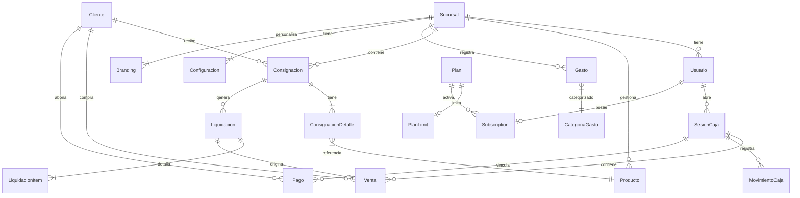

# 📘 Manual Completo del Sistema — POS & Consignaciones

> Sistema de gestión comercial **Fullstack SaaS** para PyMEs que trabajan con consignaciones, ventas directas y múltiples sucursales.

---

## 📑 Índice

1. [¿Qué es el Sistema?](#qué-es-el-sistema)
2. [Roles y Accesos](#roles-y-accesos)
3. [Módulos Funcionales](#módulos-funcionales)
   - [Dashboard](#dashboard)
   - [Inventario y Productos](#inventario-y-productos)
   - [Ventas POS](#ventas-pos)
   - [Consignaciones y Liquidaciones](#consignaciones-y-liquidaciones)
   - [Clientes y Cuentas Corrientes](#clientes-y-cuentas-corrientes)
   - [Caja](#caja)
   - [Gastos y Finanzas](#gastos-y-finanzas)
   - [Catálogo Público (Tienda Online)](#catálogo-público-tienda-online)
   - [Notificaciones](#notificaciones)
   - [Configuración y Sucursales](#configuración-y-sucursales)
   - [Suscripciones SaaS](#suscripciones-saas)
4. [Flujos Clave del Sistema](#flujos-clave-del-sistema)
5. [Rutas de la Aplicación](#rutas-de-la-aplicación)
6. [Modelo de Datos](#modelo-de-datos)
7. [Arquitectura Técnica](#arquitectura-técnica)
8. [Configuración del Entorno](#configuración-del-entorno)
9. [Despliegue y Producción](#despliegue-y-producción)
10. [Directorio de Documentación](#directorio-de-documentación)

---

## ¿Qué es el Sistema?

**consignacion-app** es una plataforma SaaS de gestión comercial diseñada para pequeños y medianos comercios que:

- Manejan stock de productos propio y/o en consignación (mercadería entregada a terceros).
- Necesitan controlar múltiples sucursales con datos e inventario aislados.
- Requieren un punto de venta (POS) directo con control de caja y métodos de pago.
- Desean tener su propio catálogo/tienda en línea público.

El sistema opera bajo un **modelo de licenciamiento mensual (SaaS)**, integrando cobros recurrentes a través de MercadoPago y PayPal.

---

## Roles y Accesos

| Rol | Descripción | Restricciones |
|:---|:---|:---|
| `ADMIN` | Propietario sin restricciones. Puede gestionar empleados, sucursales y datos de facturación. | Ninguna |
| `EMPLEADO` | Acceso operativo restringido a la sucursal asignada en su perfil. | No puede cambiar de sucursal ni ver datos de otras. |

### Sistema de Sesiones

- El login genera un **JWT** almacenado en una cookie `HttpOnly`.
- Cada sesión se valida contra la tabla `UserSession` en la DB, permitiendo **revocación remota** de sesiones activas.
- Los ADMINs pueden impersonar una sucursal distinta enviando el header `x-sucursal-id`. Los EMPLEADOs tienen ese header bloqueado a nivel de middleware.

> **Primer uso**: Si la base de datos no tiene ningún usuario, el sistema redirige automáticamente a `/setup` para crear el primer administrador.

---

## Módulos Funcionales

### Dashboard

Vista central de indicadores clave de rendimiento (KPIs) para el comercio:

- Ventas del día / semana / mes y comparativa.
- Stock bajo y productos próximos a vencer.
- Consignaciones activas en la calle.
- Gráficos de ingresos, métodos de pago y top productos más vendidos.
- Acceso a reportes en PDF (POS o Consignación), compartibles vía enlace público.

---

### Inventario y Productos

Gestión centralizada del catálogo de productos:

- **Alta/Baja/Edición** de productos con código de barras, SKU, precios de costo y venta, IVA y descripción.
- **Stock por Sucursal (`StockSucursal`)**: El stock física y consignado se gestiona por local de forma independiente.
- **Categorías con colores**: Los productos pueden agruparse en categorías por sucursal para filtrado rápido.
- **Control de Vencimientos**: Campo `fechaVencimiento` con notificaciones automáticas configurables por días de anticipación.
- **Historial de Movimientos**: Trazabilidad completa — entradas, salidas, ajustes, mermas, consignaciones.
- **Precios Override por Sucursal**: Una sucursal puede tener un precio distinto al precio base del producto.

---

### Ventas POS

Terminal de venta directa para ventas casuales en mostrador:

- Buscador de productos por nombre o lector de código de barras.
- Carrito con descuentos por ítem o categoría.
- Soporte de múltiples **métodos de pago**: Efectivo, Transferencia, Tarjeta, Otro.
- Generación de **ticket** con link compartible para el cliente.
- Descuento por recargo de tarjeta configurable (`porcentajeInteresTarjeta`).
- Las ventas quedan vinculadas a la sesión de caja activa.

---

### Consignaciones y Liquidaciones

El módulo central del sistema, diseñado para comercios de distribución:

**Flujo completo:**

```
Entrega mercadería → [Consignacion] → [ConsignacionDetalle]
         │
         ▼
    Cliente vende → [Liquidacion] ──────→ [Venta] (tipo: LIQUIDACION)
         │
         ▼
  Actualiza saldo deudor del cliente
```

1. **Nueva Consignación**: Se registra el cliente, productos y unidades entregadas. Se genera un `numeroFolio` secuencial por cliente.
2. **Remito Digital**: Se genera un link compartible (`ShareLink`) para que el cliente vea su remito sin necesidad de usuario.
3. **Liquidación**: El sistema registra cuánto se vendió y cuánto se devolve. Se hace una snapshot del precio al momento de liquidar.
4. **Cierre**: Una consignación pasa a `CERRADA` cuando todas las unidades entregadas están liquidadas o devueltas.

---

### Clientes y Cuentas Corrientes

- Registro de clientes con nombre, teléfono, dirección y sucursal de pertenencia.
- **Saldo deudor** (`saldoCuenta`): Cada liquidación suma al saldo. Un monto positivo indica deuda pendiente.
- **Pagos a cuenta** (`Pago`): Registro de abonos parciales o totales para reducir la deuda del cliente.
- Historial de todas las transacciones por cliente.

---

### Caja

Control del flujo de dinero físico por turno de trabajo:

- **Apertura**: El empleado/admin inicia la sesión con el monto de dinero inicial en la caja.
- **Movimientos de Caja**: Ingresos o egresos manuales (depósitos, retiros de propietario, etc.) con motivo.
- **Cierre**: Se registra el monto real contado y se calcula la diferencia vs. el monto esperado (auditoría).
- Toda venta y pago de consignación realizado durante la sesión queda vinculado a ella.

---

### Gastos y Finanzas

Control de egresos del comercio:

- Categorías de gasto por sucursal (`CategoriaGasto`): Alquiler, servicios, insumos, sueldos, etc.
- **Gastos únicos o recurrentes** (semanal, mensual, anual).
- **Cuotas**: Los gastos en cuotas generan automáticamente las N cuotas restantes con su fecha de vencimiento.
- Subida de **comprobante** (imagen/PDF).
- Estado: `PAGADO` o `PENDIENTE`.

---

### Catálogo Público (Tienda Online)

Cada sucursal puede habilitar una tienda pública accesible sin login:

- **Configuración de Marca (`Branding`)**: Nombre comercial, colores primario/secundario, logo, banner o carrusel de banners, links a redes sociales.
- **Temas de Tienda**: Selección de layout (`modern`, `minimal`, etc.).
- **Catálogo Filtrable**: Por categoría, precio o búsqueda de texto.
- **Lista de Precios**: Opcionalmente mostrar solo una lista de productos sin imágenes ni precios.
- **Botón de WhatsApp**: Link de contacto con mensaje personalizado por producto.
- **Pedidos por Catálogo**: Opcionalmente integrar pago online via MercadoPago Checkout.

---

### Notificaciones

Central de alertas en tiempo real:

| Tipo | Descripción |
|:---|:---|
| `LOW_STOCK` | El stock de un producto cayó por debajo del mínimo configurado. |
| `OUT_OF_STOCK` | Un producto llegó a cero unidades. |
| `EXPIRATION_NEAR` | Un producto está próximo a su fecha de vencimiento. |
| `PRODUCT_EXPIRED` | Un producto superó su fecha de vencimiento. |
| `CONSIGNMENT_ALERT` | Una consignación lleva muchos días sin movimiento. |
| `SUBSCRIPTION_EXPIRING` | El plan de suscripción está por vencer. |
| `CLIENT_REGISTERED` | Un nuevo cliente se registró vía catálogo público. |
| `NEW_ORDER` / `PAYMENT_RECEIVED` | Pedido o pago ingresado desde la tienda. |

Las notificaciones usan **fingerprinting** para evitar duplicados. Las alertas de stock se envían vía **Socket.io** en tiempo real.

---

### Configuración y Sucursales

Panel de ajustes desde `/settings/*`:

- **Sucursales**: Alta, baja, y ajuste del nombre. Configurar cuál es la principal.
- **Branding de Tienda**: Personalización visual completa del catálogo público.
- **Seguridad / Empleados**: Creación de usuarios, asignación de sucursal y horarios laborales.
- **Configuración Operativa**: Stock mínimo global, días de anticipación para vencimientos, porcentaje de aumento en consignaciones, etc.
- **Suscripción**: Ver y gestionar el plan de facturación activo.

---

### Suscripciones SaaS

Sistema de monetización por membresía:

- **Planes (`Plan`)**: Cada plan define precios en ARS/USD y límites (`PlanLimit`): máximo de productos, usuarios, si permite consignaciones y múltiples sucursales.
- **Período de Prueba**: Configurable via variable de entorno `DEFAULT_TRIAL_DAYS`.
- **Proveedores**: MercadoPago (cobro recurrente pre-aprobado) y PayPal (suscripciones). Ambos gestionados por webhooks.
- **Códigos Promocionales (`PromoCode`)**: Extienden el acceso por N días.
- **Estados de Suscripción**: `PRUEBA` → `ACTIVO` → `ATRASADO` → `CANCELADO` / `VENCIDO`.

---

## Flujos Clave del Sistema

### Flujo: Venta POS Normal
```
Empleado → Abre caja → Busca producto → Agrega al carrito →
Selecciona cliente → Elige método de pago → Confirma venta →
Genera ticket (ShareLink) → Actualiza stock → Registra en sesión de caja
```

### Flujo: Consignación + Liquidación
```
Admin/Empleado → Nueva Consignación → Elige cliente + productos + unidades →
Genera Remito (ShareLink compartible) → Cliente vende X unidades →
Liquidación → Registra vendidas/devueltas → Genera Venta vinculada →
Actualiza saldo deudor del cliente → Actualiza stock consignado
```

### Flujo: Control de Caja
```
Inicio de turno → Abre sesión de caja con monto inicial →
Ventas y pagos se vinculan automáticamente →
Fin de turno → Cierre de caja → Ingresa monto real →
Sistema calcula diferencia → Registra el arqueo
```

---

## Rutas de la Aplicación

### Frontend (Panel de Gestión)

| Ruta | Función |
|:---|:---|
| `/` → `/login` | Acceso al sistema. |
| `/setup` | Creación del primer administrador si la DB está vacía. |
| `/dashboard` | Vista de KPIs, gráficos y alertas. |
| `/ventas/nueva` | Terminal de venta POS con carrito. |
| `/consignaciones` | Listado de consignaciones activas/cerradas. |
| `/consignaciones/nueva` | Formulario de nueva entrega en consignación. |
| `/consignaciones/[id]/liquidar` | Interfaz de liquidación de consignación. |
| `/productos` | Gestión del catálogo e inventario. |
| `/clientes` | Listado de clientes y saldos. |
| `/caja` | Panel de control de cajas y sesiones. |
| `/gastos` | Registro y gestión de egresos y cuotas. |
| `/liquidaciones` | Historial de todas las liquidaciones. |
| `/settings/*` | Configuración, sucursales, empleados y suscripción. |
| `/lista` | Catálogo público de la tienda (sin login). |
| `/ver/[shareId]` | Visor público de ticket, remito o reporte. |

### API Endpoints (Backend)

| Prefijo | Responsabilidad |
|:---|:---|
| `/api/auth/*` | Login, logout, recuperación de contraseña. |
| `/api/ventas` | Creación y consulta de ventas. |
| `/api/consignaciones` | CRUD de consignaciones y detalles. |
| `/api/liquidaciones` | Creación de liquidaciones. |
| `/api/productos` | CRUD y búsqueda por código de barras. |
| `/api/clientes` | Gestión y saldo de clientes. |
| `/api/caja` / `/api/gastos` | Control de sesiones de caja y egresos. |
| `/api/categorias` | CRUD de categorías de productos y gastos. |
| `/api/notificaciones` | Listado, lectura y eliminación de alertas. |
| `/api/subscriptions` | État de suscripción, planes y checkout. |
| `/api/public` | Endpoints anónimos para la tienda pública. |
| `/api/historial` | Exportación de reportes y auditoría. |
| `/api/dashboard` | Agregación de KPIs para el dashboard. |
| `/api/webhooks/*` | Recepción de eventos de pago (MP/PayPal). |
| `/api/cron/*` | Tareas automáticas programadas. |
| `/api/socket/dispatch` | Disparo interno de eventos Socket.io. |

---

## Modelo de Datos

Diagrama de entidades principales y sus relaciones:



### Resumen de Entidades

| Modelo | Descripción |
|:---|:---|
| `Usuario` | Cuenta de acceso. Tiene rol (`ADMIN`/`EMPLEADO`) y sucursal asignada. |
| `Sucursal` | Unidad de negocio. Todos los datos están particionados por sucursal. |
| `Branding` | Apariencia visual de la tienda pública: logo, banners, colores y tema. |
| `Producto` / `StockSucursal` | Catálogo central con stock independiente por sucursal. |
| `Categoria` | Agrupación de productos por sucursal con color asignado. |
| `Consignacion` | Entrega de mercadería a un cliente. Folios secuenciales por cliente. |
| `Liquidacion` | Rendición de cuentas de una consignación, genera una `Venta`. |
| `Venta` / `VentaDetalle` | Transacción de ingreso (directa o por liquidación). |
| `Cliente` / `Pago` | Comprador con cuenta corriente y registro de abonos. |
| `SesionCaja` / `MovimientoCaja` | Turnos de caja con auditoría de ingresos/egresos manuales. |
| `Gasto` / `CategoriaGasto` | Egreso del comercio, soporte para cuotas recurrentes. |
| `Plan` / `Subscription` | Gestión de licencias del sistema SaaS. |
| `Notification` | Alertas del sistema con fingerprinting anti-duplicados. |
| `ShareLink` | URLs de acceso público temporal para tickets, remitos y reportes. |

---

## Arquitectura Técnica

### Stack Completo

| Capa | Tecnología | Versión |
|:---|:---|:---|
| Framework Web | Next.js (App Router) | 16.x |
| UI Library | React | 19.x |
| Estilos | Tailwind CSS + Shadcn UI + Radix UI | 4.x |
| ORM | Prisma Client | 7.x |
| Base de Datos | PostgreSQL | — |
| Tiempo Real | Socket.io | 4.x |
| Autenticación | JWT (`jose` / `jsonwebtoken`) | — |
| Pagos | Mercado Pago SDK + PayPal SDK | — |
| Correo Electrónico | Resend | — |
| Gráficos | Recharts | 3.x |
| Generación de PDF | Puppeteer | 24.x |
| Estado Global | Zustand | 5.x |
| Formularios | React Hook Form + Zod | — |
| Animaciones | Motion (Framer Motion) | 12.x |

### Servidor Personalizado

El sistema usa un **servidor Node.js propio** (`server.ts`) en lugar de `next start`, para:

1. Capturar conexiones de Socket.io **antes** de que Next.js las procese.
2. Proveer un endpoint `/api/socket/dispatch` para que las API Routes puedan emitir eventos de forma segura sin acceso directo al servidor.

### System Guard (Inicialización)

El Route Group `(system-guard)` contiene un `layout.tsx` que verifica si existe al menos un usuario en la DB. Si no existe, redirige a `/setup`, previniendo el acceso sin administrador configurado.

### Seguridad

- **JWT + `UserSession`**: Doble validación: firma del token y registro activo en DB.
- **Isolation por Sucursal**: Middleware bloquea a los empleados a su `sucursalId`.
- **Webhooks**: Verificación de firma de MercadoPago y PayPal antes de procesar.
- **`ShareLink`**: URLs con hash opaco, expiración y límite de vistas.
- **Passwords**: Hasheados con `bcryptjs`.

---

## Configuración del Entorno

### Variables de Entorno Requeridas (`.env`)

| Variable | Descripción | Requerida |
|:---|:---|:---|
| `DATABASE_URL` | URI de conexión a PostgreSQL. | ✅ |
| `JWT_SECRET` | Secreto para firmar tokens de autenticación. | ✅ |
| `JWT_COOKIE_NAME` | Nombre de la cookie de sesión. | ✅ |
| `CRON_SECRET` | Token para validar llamadas a los endpoints `/api/cron/*`. | ✅ |
| `PDF_SECRET` | Clave de firmado para la generación de PDFs. | ✅ |
| `SHARE_LINK_SECRET` | Clave de encriptación de ShareLinks. | ✅ |
| `NEXT_PUBLIC_APP_URL` | URL base de la aplicación (usada en correos y links). | ✅ |
| `SOCKET_DISPATCH_URL` | URL interna del servidor Socket.io dispatch. | ✅ |
| `MP_ACCESS_TOKEN` | Token de acceso de MercadoPago. | Suscripciones MP |
| `MP_PUBLIC_KEY` | Clave pública de MercadoPago. | Suscripciones MP |
| `MP_WEBHOOK_SECRET` | Secreto para validar webhooks de MercadoPago. | Suscripciones MP |
| `PAYPAL_CLIENT_ID` | ID de aplicación de PayPal. | Suscripciones PP |
| `PAYPAL_SECRET` | Secreto de PayPal. | Suscripciones PP |
| `PAYPAL_WEBHOOK_ID` | ID del webhook de PayPal. | Suscripciones PP |
| `RESEND_API_KEY` | Clave API de Resend para el envío de correos. | Notificaciones |
| `DEFAULT_TRIAL_DAYS` | Días del período de prueba para nuevas cuentas. | Opcional (def: 7) |
| `ADMIN_EMAIL` / `ADMIN_PASSWORD` | Credenciales del admin en el seed inicial. | Solo seed |

---

## Despliegue y Producción

### Scripts del Proyecto

```bash
# Desarrollo local (servidor custom con hot reload)
npm run dev

# Construcción de producción (genera cliente Prisma + build Next.js)
npm run build

# Servidor de producción (aplica migraciones DB + levanta servidor custom)
npm start

# Ejecutar seed de datos inicial
npm run seed
```

### Pasos para Primer Despliegue

1. **Preparar la base de datos PostgreSQL** y copiar la `DATABASE_URL`.
2. **Configurar todas las variables de entorno** en la plataforma de hosting.
3. **Ejecutar la construcción**: `npm run build`.
4. **Iniciar el servidor**: `npm start` (aplica migraciones automáticamente).
5. **Opcionalmente ejecutar el seed**: `npm run seed` para crear el admin inicial y los planes base.
6. **Acceder a la aplicación** → si la DB está vacía, redirigirá a `/setup`.

### Plataformas Compatibles

- **Railway** (configuración de referencia documentada en `.env.example`).
- Cualquier plataforma con soporte para Node.js + PostgreSQL y variables de entorno.

---

## Directorio de Documentación

| Archivo | Descripción |
|:---|:---|
| [`README.md`](./README.md) | Descripción del proyecto, características y guía de inicio rápido. |
| [`DOCUMENTACION.md`](./DOCUMENTACION.md) | Mapa de rutas, diagrama de arquitectura y resumen de funcionalidades. |
| [`TECNICO.md`](./TECNICO.md) | Detalles de implementación: servidor custom, autenticación JWT y patrones de API. |
| [`ROADMAP.md`](./ROADMAP.md) | Hitos completados y funcionalidades planificadas a futuro. |
| [`MANUAL_SISTEMA.md`](./MANUAL_SISTEMA.md) | **Este archivo.** Documentación completa y centralizada del sistema. |
| `prisma/schema.prisma` | Modelo completo de la base de datos. |
| `.env.example` | Plantilla con todas las variables de entorno necesarias. |

---

> *Última actualización: Marzo 2026 — v0.1.0*
