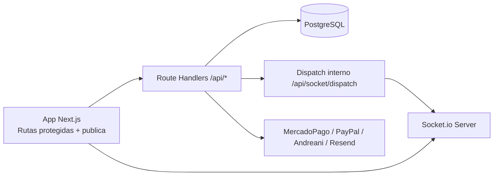

# Guia Tecnica del Proyecto

## 1) Vision tecnica

`consignacion-app` es una plataforma B2B SaaS para operacion comercial con dos dominios principales:

- POS (ventas directas, caja, pagos y gastos).
- Consignaciones (entrega, liquidacion y devolucion de mercaderia).

La solucion se implementa con Next.js App Router y un servidor Node.js custom para integrar Socket.io en el mismo proceso.

## 2) Stack y runtime

| Capa | Tecnologia | Notas |
| :--- | :--- | :--- |
| Web app | Next.js 16 + React 19 | App Router con Route Handlers |
| Estilos | Tailwind CSS 4 + shadcn/Radix | UI de panel y tienda publica |
| Persistencia | Prisma 7 + PostgreSQL | Adapter `@prisma/adapter-pg` |
| Tiempo real | Socket.io 4 | Servido desde `server.ts` |
| Auth | JWT (`jose`) + cookie HttpOnly | Sesion persistida en DB |
| Validacion | Zod | Contratos de entrada/salida |
| Reportes | Puppeteer | HTML a PDF |
| Integraciones | MercadoPago, PayPal, Andreani, Resend | Cobros, envios y email |

## 3) Arquitectura de alto nivel

Puntos clave:

- `server.ts` inicia Next y Socket.io en el mismo proceso.
- `/api/socket/dispatch` permite emitir eventos en tiempo real desde handlers HTTP.
- El resto de requests se delega al handler nativo de Next.

## 4) Seguridad y autenticacion

### JWT + sesion revocable

1. Login crea JWT y lo guarda en cookie HttpOnly (`JWT_COOKIE_NAME`).
2. Las APIs protegidas usan `requireAuth()` (`src/lib/requireAuth.ts`).
3. Ademas de verificar firma JWT, se valida hash de token en `UserSession`.
4. Si la sesion fue revocada, se responde `401` y se limpia la cookie.

### Aislamiento por sucursal

- El sistema usa `x-sucursal-id` para contexto de trabajo.
- Si el usuario es `ADMIN`, puede seleccionar sucursal activa.
- Si es `EMPLEADO`, queda fijado a su `sucursalId`.

### Proxy de rutas protegidas

`src/proxy.ts` aplica redireccion de empleados en frontend:

- Lista blanca principal: `/ventas`, `/caja/abrir`, `/caja/cerrar`, `/caja/historial`.
- Cualquier otra ruta protegida redirige a `/ventas/nueva`.

## 5) Modelo de datos y dominios

El esquema principal esta en `prisma/schema.prisma`.

### Dominios

- Identidad y acceso: `Usuario`, `UserSession`, `AuditLog`, `HorarioLaboral`, `ResetPasswordToken`.
- Estructura tenant: `Sucursal`, `Configuracion`, `Branding`, `BrandingBanner`.
- Catalogo e inventario: `Producto`, `Categoria`, `Subcategoria`, `StockSucursal`, `MovimientoStock`.
- POS y caja: `Venta`, `VentaDetalle`, `Caja`, `SesionCaja`, `MovimientoCaja`, `Pago`, `Envio`.
- Consignaciones: `Consignacion`, `ConsignacionDetalle`, `Liquidacion`, `LiquidacionItem`.
- Gastos: `Gasto`, `GastoSucursal`, `CategoriaGasto`.
- SaaS: `Plan`, `PlanLimit`, `Subscription`, `PromoCode`.
- Sistema: `Notification`, `ShareLink`.

### Reglas tecnicas relevantes

- Unicidad de producto por sucursal en `codigoBarra` y `sku`.
- Folio de consignacion por cliente (`numeroFolio`) indexado con `clienteId`.
- `ShareLink` con `codeHash` unico, expiracion y maximo de vistas.
- `Notification.fingerprint` evita duplicados.
- `onDelete: Restrict` en relaciones criticas evita borrar historial operativo.

## 6) Capa API

### Convenciones

- Implementacion en `src/app/api/**/route.ts`.
- Respuestas JSON, con validacion de permisos via `requireAuth`.
- Contexto de sucursal por header `x-sucursal-id`.
- Cron endpoints protegidos por secreto (`CRON_SECRET`).

### Modulos de endpoints

- Auth: `/api/auth/*`
- Dashboard: `/api/dashboard/*`
- Productos/Categorias/Subcategorias: `/api/productos/*`, `/api/categorias/*`, `/api/subcategorias/*`
- Ventas/Pagos/Clientes: `/api/ventas/*`, `/api/pagos/*`, `/api/clientes/*`
- Consignaciones/Liquidaciones: `/api/consignaciones/*`, `/api/liquidaciones/*`
- Caja y settings POS: `/api/settings/pos/*`
- Configuracion general y branding: `/api/settings/general`, `/api/settings/branding*`
- Gastos: `/api/gastos*`
- Seguridad: `/api/security/*`
- Publico: `/api/public/*`
- Setup inicial: `/api/setup/*`
- Webhooks: `/api/webhooks/mercadopago`, `/api/webhooks/paypal`
- Jobs programados: `/api/cron/*`

## 7) Frontend y organizacion de rutas

Estructura de rutas en App Router:

- `src/app/(system-guard)/...`: autenticacion y rutas privadas.
- `src/app/(system-guard)/(protected)/...`: modulos internos (dashboard, ventas, caja, settings, etc.).
- `src/app/lista`: tienda publica.
- `src/app/ver/*`: vistas HTML para documentos y reportes.
- `src/app/x/[code]`: resolucion de links compartidos.

## 8) Tiempo real

El flujo de notificaciones usa dos componentes:

1. Persistencia de alertas en `Notification`.
2. Emision Socket.io por evento `new-notification`.

Autenticacion Socket.io:

- Se extrae JWT desde cookies del handshake.
- Se valida firma JWT antes de aceptar la conexion.

## 9) Configuracion de entorno

Base: `DATABASE_URL`, `JWT_SECRET`, `JWT_COOKIE_NAME`, `NEXT_PUBLIC_APP_URL`.

Produccion recomendada:

- Definir `NEXT_PUBLIC_BASE_URL`.
- Definir `SOCKET_DISPATCH_SECRET` (si no, cae a `CRON_SECRET`).
- Definir secretos de `PDF_SECRET` y `SHARE_LINK_SECRET`.

Integraciones:

- MercadoPago: `MP_ACCESS_TOKEN`, `MP_PUBLIC_KEY`, `MP_WEBHOOK_SECRET`.
- PayPal: `PAYPAL_CLIENT_ID`, `PAYPAL_SECRET`, `PAYPAL_WEBHOOK_ID`, `PAYPAL_API_URL`.
- Resend: `RESEND_API_KEY`.

Referencia completa: `.env.example`.

## 10) Build, arranque y despliegue

Scripts principales (`package.json`):

- `npm run dev`: `tsx server.ts`.
- `npm run build`: `prisma generate && next build`.
- `npm start`: `prisma migrate deploy && tsx server.ts`.

Notas operativas:

- El start aplica migraciones antes de levantar servicio.
- El servidor escucha en `0.0.0.0` para entornos cloud.
- En dev, se recomienda no usar `next dev` porque omite la integracion Socket.io de `server.ts`.

## 11) Deuda tecnica visible

- Existen `@ts-nocheck` en piezas centrales (`apiService.ts`, `requireAuth.ts`) que reducen garantias de tipado.
- Hay archivos de schema historicos/copia en `prisma/` (`schema_v2`, `schema_v3`, `schema copy`) que pueden confundir el source of truth.
- Conviene publicar contrato OpenAPI para la superficie `/api/*` y evitar divergencia entre frontend y backend.

## 12) Referencias directas

- `server.ts`
- `src/lib/auth.ts`
- `src/lib/requireAuth.ts`
- `src/proxy.ts`
- `src/lib/prisma.ts`
- `src/lib/apiService.ts`
- `prisma/schema.prisma`
