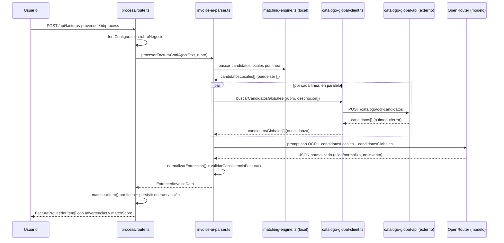

# Diseño: API Central de Catálogo Global por Rubro para Normalización OCR de Productos

## Contexto arquitectónico actual (evidencia con file:line)

Flujo confirmado hoy: `upload/route.ts` sube la factura → `[id]/process/route.ts` dispara el procesamiento → `extraerTextoFactura()` (OCR local) → `procesarFacturaConIA()` (`src/lib/ai/invoice-ai-parser.ts`, arma prompt + JSON schema desde `invoice-extraction.config.ts`, llama OpenRouter) → `normalizarExtraccion()` → `validarConsistenciaFactura()` (agregado en `mejora-precision-lineas-factura-ocr`) → de vuelta en `process/route.ts`, se corre `matchearItem()` por línea contra el catálogo local (`matching-engine.ts`) y se persiste todo en una transacción.

Fuentes de contexto que el modelo recibe hoy, todas locales a la instancia:

- `Configuracion.rubroNegocio` (`prisma/schema.prisma:44`, agregado en `rubro-contexto-ocr`) — string libre o una de 8 opciones fijas, usado como párrafo de contexto en `buildInvoiceExtractionPrompt()`.
- `getAtributosTipicos(rubro)` (`src/modules/invoices/config/rubros.ts`) — sugiere qué atributos extra son típicos del rubro (lote, talle, ML, etc.), no productos concretos.
- `ProductoProveedorAlias` (`prisma/schema.prisma:828`) — mapeo aprendido `(proveedorId, textoNormalizado) → productoId`, específico de ese negocio y ese proveedor.
- Catálogo `Producto` del propio negocio, vía `matchearItem()` en `matching-engine.ts` — solo lo que ese negocio ya tiene cargado.

Ninguna de estas cuatro fuentes le dice al modelo "estos son productos reales que existen en el mundo, del mismo rubro, aunque este negocio nunca los haya cargado". Esa es la fuente que agrega esta propuesta.

## Decisión 1: la API central es un servicio y una base de datos separados — y hoy vive fuera de este repo

**Elección**: servicio externo `catalogo-global-api`, con su propio código, `package.json`/Next.js/Prisma, **base de datos Postgres propia** (no la de ningún cliente) y **deploy independiente** — no un módulo más de `src/` de la app cliente ni parte operativa de este repo.

**Por qué tiene que ser una base de datos y un deploy separados (esto no es negociable)**: el proyecto es explícitamente single-tenant — un deploy de base de datos por cliente (ver `Configuracion.sucursalId @unique @default(1)` y el resto del modelo, todo escrito asumiendo una sola empresa por instancia). Si `ProductoGlobal` viviera en el schema Prisma de `consignacion-app`, cada cliente tendría su **propia copia** del catálogo, poblada por su **propio cron** — exactamente lo que esta propuesta busca evitar (duplicación, y cada instancia pegándole por separado a una API no oficial de Precios Claros con rate limit desconocido, ver Decisión 6). Un catálogo global compartido por _todos_ los negocios necesita, por definición, vivir en una base de datos que no pertenece a ningún cliente individual.

**Estado actual**: originalmente se planteó convivir en el mismo repositorio, pero operativamente el servicio ya fue separado del árbol de `consignacion-app`. La justificación arquitectónica importante sigue siendo la misma: el aislamiento real lo garantizan la **base de datos distinta**, el **deploy independiente** y el **contrato HTTP explícito** entre servicios.

**Alternativa descartada**: correr el catálogo global como otra tabla en la misma base Postgres de cada cliente, sincronizada por replicación. Descartada por peso (duplicar todo el catálogo en cada base) y por acoplar el schema de cada cliente a un dato que no le pertenece — contradice el principio ya establecido de este proyecto de mantener cada instancia liviana y aislada.

## Decisión 2: stack de la API central — Next.js + Prisma + PostgreSQL (route handlers, sin UI)

**Elección**: mismo stack real de este proyecto (Next.js App Router solo como capa de API — sin páginas, solo `app/api/**/route.ts` — Prisma 7, PostgreSQL), no NestJS/MySQL.

**Por qué**: el equipo ya conoce y mantiene este stack en producción (este mismo repo). Introducir NestJS/MySQL como propone un borrador previo de esta idea agregaría un segundo stack de backend a mantener sin ningún beneficio concreto — Next.js API-only cubre perfectamente un servicio HTTP sin UI, y Prisma + Postgres ya está probado en este proyecto para el mismo tipo de cargas (catálogos, búsqueda por texto, índices).

**Búsqueda de texto para la v1**: `pg_trgm` (extensión nativa de PostgreSQL) + `nombreBusqueda`/`textoAliasBusqueda` normalizados con la misma función `normalizeText()` del punto siguiente. Evita sumar una dependencia de infraestructura nueva (Meilisearch/Typesense) antes de tener evidencia de que el trigram no alcanza — coherente con "Fuera del Alcance" en `proposal.md`.

## Modelo de datos de la API central

```prisma
// catalogo-global-api/prisma/schema.prisma (servicio externo, DB propia)

model ProductoGlobal {
  id                 String   @id @default(cuid())

  codigoBarras       String?
  nombreOriginal     String
  nombreNormalizado  String
  nombreBusqueda     String   // normalizado con normalizeText(), indexado con pg_trgm

  marca              String?
  presentacion       String?

  rubro              String   // mismos slugs que RUBROS en src/modules/invoices/config/rubros.ts de este repo
  categoria          String?
  subcategoria       String?

  fuente             String   // "CSV_MANUAL" en v1; "PRECIOS_CLAROS" | "OPEN_FOOD_FACTS" en fases futuras
  fuenteId           String?

  activo             Boolean  @default(true)
  creadoEn           DateTime @default(now())
  actualizadoEn      DateTime @updatedAt

  aliases            AliasProductoGlobal[]

  @@index([rubro])
  @@index([categoria])
  @@index([marca])
  @@index([codigoBarras])
  @@unique([codigoBarras, fuente, rubro])
}

`codigoBarras` es nullable a nivel de columna (por si algún día se carga un producto sin código real), pero `upsertProductoGlobal()` (usado tanto por `POST /admin/import/csv` como por el cron de sync) lo exige no vacío en la validación de entrada — sin él no hay forma de hacer upsert idempotente por `(codigoBarras, fuente, rubro)` sin arriesgar duplicados. Precios Claros siempre trae código de barras, así que esto no es una restricción real para la fuente principal.

**Por qué `(codigoBarras, fuente, rubro)` y no solo `(codigoBarras, fuente)`**: surgió al implementar la heurística de clasificación (tarea 1.12, `src/lib/clasificacion.ts`) — muchos productos (Coca-Cola, cerveza, snacks) son candidatos válidos tanto para `kiosco` como para `almacen`. Con una única fila por `(codigoBarras, fuente)`, el producto solo podría tener **un** rubro, y `/catalogo/ocr-candidatos` (que siempre filtra por un único rubro exacto) nunca lo encontraría para el rubro que quedó afuera. La solución es una fila por rubro aplicable, todas con el mismo `codigoBarras`/`fuente` — `clasificarProducto()` devuelve `rubros: string[]`, y `buildUpsertProductoGlobalQueriesPorRubro()` arma una query de upsert por cada uno.

model AliasProductoGlobal {
  id                 String   @id @default(cuid())
  productoGlobalId   String
  productoGlobal     ProductoGlobal @relation(fields: [productoGlobalId], references: [id])

  textoAlias         String
  textoAliasBusqueda String

  @@index([textoAliasBusqueda])
  @@index([productoGlobalId])
}
```

`RubroCatalogo`/`CategoriaCatalogo` como tablas separadas quedan fuera de la v1: el slug de rubro es una constante compartida (mismo valor que `RUBROS` en `src/modules/invoices/config/rubros.ts` de este repo) — agregar una tabla de metadatos de rubro es una mejora de una iteración posterior si hace falta un endpoint `/catalogo/rubros` dinámico; en la v1 esa lista se hardcodea en ambos lados y se mantiene sincronizada manualmente (documentado como deuda conocida, bajo riesgo porque la lista de rubros cambia con muy poca frecuencia).

## Normalización de texto (compartida por convención, no por código compartido)

La API central reimplementa la misma función de normalización que ya existe en este repo, para que el texto que se compara de un lado y del otro sea comparable:

```typescript
export function normalizeText(value: string): string {
  return value
    .toLowerCase()
    .normalize("NFD")
    .replace(new RegExp("[\\u0300-\\u036f]", "g"), "")
    .replace(/[^a-z0-9]+/g, " ")
    .replace(/\s+/g, " ")
    .trim();
}
```

No se extrae a un paquete npm compartido en esta iteración — son dos repos con ciclos de deploy independientes; duplicar 10 líneas de función pura es más simple que mantener un paquete privado versionado para ese único propósito. Si en el futuro se comparte más lógica (scoring, reglas OCR), se reevalúa.

## Endpoints de la API central

### `POST /catalogo/ocr-candidatos`

Request:

```json
{
  "rubro": "kiosco",
  "descripcion": "COCA-COLA 8x2,25",
  "categoriaHint": "bebidas",
  "limit": 10
}
```

Response:

```json
{
  "query": "COCA-COLA 8x2,25",
  "queryNormalizada": "coca cola 8x2 25",
  "candidatos": [
    {
      "id": "prod_global_001",
      "codigoBarras": "7790895000998",
      "nombreNormalizado": "Coca-Cola Sabor Original 2.25 L",
      "marca": "Coca-Cola",
      "presentacion": "2.25 L",
      "categoria": "Bebidas",
      "score": 94
    }
  ]
}
```

### `GET /catalogo/barcode/:codigoBarras` — lookup exacto, sin scoring.

### `GET /health` — usado por el cliente HTTP de este repo para decidir si vale la pena intentar (ver Decisión 4).

### `POST /admin/import/csv` — protegido con una API key de admin distinta a la de instancia; no expuesto a instancias de cliente.

Ranking v1 (simple, sin pesos configurables todavía): coincidencia exacta de código de barras > coincidencia exacta de `nombreBusqueda`/alias > `similarity()` de `pg_trgm` sobre `nombreBusqueda`, filtrado siempre por `rubro` primero (nunca se devuelven candidatos de otro rubro).

## Decisión 3: qué datos viajan hacia la API central — mínimos, sin datos del negocio

**DEBE** enviarse únicamente: `rubro`, `descripcion` (texto OCR crudo de la línea), `categoriaHint` (opcional), `limit`.

**NO DEBE** enviarse: factura completa, CUIT/datos fiscales del cliente, stock, precios de compra internos, usuarios, ni identificar al cliente más allá de la API key usada para autenticar (que la API central puede usar para rate-limit/métricas, pero no para personalizar resultados).

**DEBERÍA** poder desactivarse el envío de logs de queries completas en la API central (flag de configuración del servicio), para no acumular indefinidamente texto OCR de terceros que no dieron consentimiento explícito de retención.

## Corrección post-implementación (Fase 2, 2026-07-05): matching post-hoc, no inyección en el prompt de IA

Al implementar la Fase 2 se detectó que el resto de esta sección (Decisión 4, la secuencia completa y los Escenarios 1/3) describe un pipeline que ya no es el real: asumen que `procesarFacturaConIA()` recibe líneas ya separadas y les busca candidatos (locales y globales) **antes** de llamar a la IA, para inyectarlos en el prompt.

Eso dejó de ser así en algún punto entre este diseño original y `rubro-contexto-ocr`/`mejora-precision-lineas-factura-ocr`: hoy `procesarFacturaConIA()` (`invoice-ai-parser.ts`) le manda a la IA el texto OCR completo de la factura en un solo llamado, y la IA devuelve el array de items — las líneas individuales **no existen como input**, son un output de ese llamado. El matching contra catálogo local (`matchearItem()`) y contra `ProductoProveedorAlias` corre **después**, en `process/route.ts`, usando `item.rawDescription` ya extraído por la IA. Nunca se le muestra al modelo.

**Decisión tomada**: en vez de una segunda pasada de IA (que hubiera sido fiel al diseño original pero duplica costo/latencia por factura), el candidato global se resuelve **post-hoc, igual que el matching local**:

- Después de `matchearItem()` por línea (`process/route.ts`), para los items donde `match.productoId === null` (mismo criterio que usa el diálogo de revisión para mostrar "requiere alta" / crear producto nuevo) se llama `buscarCandidatosGlobales({ rubro, descripcion: item.rawDescription, limit: 3 })` en paralelo (`Promise.all`), usando el `rubroNegocio` que ya se leía para el prompt.
- El mejor candidato (primero de la lista, ya viene rankeado por la API central) se persiste en el propio `FacturaProveedorItem` (columnas nuevas `candidatoGlobalId`/`candidatoGlobalNombre`/`candidatoGlobalCodigoBarras`/`candidatoGlobalScore` — no existían en el modelo de datos original de esta sección, se agregaron porque la sugerencia debe sobrevivir entre el momento de procesar la factura y el momento en que el usuario la revisa, que pueden estar separados en el tiempo).
- La IA **nunca ve** el candidato global — no hay cambio de prompt ni de schema de extracción para esto. El valor práctico pasa a ser: cuando no hay match local, el candidato global mejora el prellenado del formulario "crear producto nuevo" (`initialValuesParaNuevoProducto` en `factura-proveedor-dialog.tsx`) con un nombre/código de barras normalizados en vez del texto OCR crudo — y si el usuario confirma con ese producto (nuevo o existente), `productoGlobalId` queda guardado en el `ProductoProveedorAlias` (Decisión 5, sin cambios).
- Esto conserva todas las propiedades no negociables del diseño original: nunca bloquea el pipeline (mismo `buscarCandidatosGlobales()` que degrada a `[]`), no agrega una segunda pasada de IA, no cambia el schema/JSON de extracción, y sigue siendo aditivo/reversible.

Las Decisiones 1, 2, 3, 5 y 6 de abajo, y el modelo de datos de la API central, no cambian. Lo que cambia es únicamente _quién_ consume `buscarCandidatosGlobales()` y _cuándo_ (después de la IA, no antes) — la sección de Decisión 4 y el diagrama de secuencia que sigue quedan como registro histórico de la primera versión del diseño, no como el flujo implementado.

## Decisión 4: resiliencia — la API central nunca bloquea el procesamiento de una factura

```typescript
// src/lib/ai/catalogo-global-client.ts (nuevo, este repo)

export async function buscarCandidatosGlobales(params: {
  rubro: string;
  descripcion: string;
  categoriaHint?: string;
  limit?: number;
}): Promise<CandidatoGlobal[]> {
  if (!process.env.CATALOGO_API_URL) return []; // feature-off si no está configurada

  try {
    const res = await fetch(
      `${process.env.CATALOGO_API_URL}/catalogo/ocr-candidatos`,
      {
        method: "POST",
        headers: {
          "Content-Type": "application/json",
          Authorization: `Bearer ${process.env.CATALOGO_API_KEY}`,
        },
        body: JSON.stringify(params),
        signal: AbortSignal.timeout(
          Number(process.env.CATALOGO_API_TIMEOUT_MS ?? 2000),
        ),
      },
    );
    if (!res.ok) throw new Error(`catalogo-global-api respondió ${res.status}`);
    const data = await res.json();
    return data.candidatos ?? [];
  } catch (error) {
    logger.warn(
      "catalogo-global-api no disponible, continuando sin candidatos globales",
      { error },
    );
    return [];
  }
}
```

**DEBE** tener timeout corto (default 2000ms, configurable por env) — una factura con 10 items no puede esperar 10 llamados HTTP lentos en serie; se llaman en paralelo con `Promise.all` desde `procesarFacturaConIA()`, cada uno con su propio timeout independiente.
**NO DEBE** reintentar automáticamente ante fallo (mismo criterio que `rubro-contexto-ocr` y `mejora-precision-lineas-factura-ocr`: sin retries encadenados).
**DEBE** degradar a `[]` ante cualquier error — el pipeline sigue exactamente el camino actual (catálogo local + alias + IA sin candidatos externos) cuando esto pasa.

## Secuencia completa (caso con candidato global)



## Decisión 5: qué se guarda localmente cuando el usuario confirma un candidato global

Se extiende `ProductoProveedorAlias` (ya existente, `prisma/schema.prisma:828`) en vez de crear un modelo nuevo — es exactamente el mismo propósito (mapear texto de factura de un proveedor a un producto local), solo que ahora una fila puede además saber que ese producto local se originó/vinculó con un producto del catálogo global:

```prisma
model ProductoProveedorAlias {
  // ...campos existentes sin cambios...
  productoGlobalId String?  // nuevo, nullable — id devuelto por catalogo-global-api, solo informativo/trazabilidad
}
```

**Por qué no un modelo nuevo `AliasProductoGlobal` en este repo**: `ProductoProveedorAlias` ya resuelve "la próxima vez que aparezca este texto, no vuelvas a preguntarle a la IA" — el propósito del borrador original para un modelo separado. Duplicar el concepto en dos tablas locales sería redundante; la única información nueva es _de dónde salió_ la sugerencia, que es un campo, no una tabla.

**Flujo**: `POST /api/facturas-proveedor/items/[id]/create-product` (o el flujo de confirmación existente en `factura-proveedor-dialog.tsx`) — cuando el item confirmado tenía `origenCandidato: "GLOBAL"` con un `productoGlobalId`, ese id se guarda en el alias creado/actualizado. No se vuelve a consultar la API central para ese texto+proveedor en adelante.

## Decisión 6: fuente de datos del catálogo piloto — cron que consulta Precios Claros y hace upsert directo

**Elección**: el catálogo de `ProductoGlobal` para el rubro piloto (`kiosco`/`almacen`) se puebla con un job programado, dentro del propio servicio `catalogo-global-api`, que consulta la API pública de Precios Claros (Secretaría de Comercio) y escribe directo a la base — sin un CSV intermedio como paso obligatorio. Mismo patrón operativo que los crons ya existentes en `consignacion-app` (`GET /api/cron/check-vencimientos`, protegido con `Authorization: Bearer $CRON_SECRET`, disparado por un scheduler externo): acá sería `GET /catalogo-global-api/api/cron/sync-precios-claros`, con su propio `CRON_SECRET`. Fuente pública, la misma que usan varios proyectos open source de terceros (ej. `martjanz/precios-claros`, `OpenDataCordoba/precios_claros`).

**Por qué upsert directo y no un CSV intermedio versionado**: un CSV en git/bucket da trazabilidad, pero para un catálogo piloto de un par de miles de productos es más ceremonia de la que hace falta antes de tener evidencia de que se necesita revisar/revertir corridas manualmente. La seguridad no depende de tener el archivo — depende de que el _código_ que escribe sea el mismo, valide y nunca trunque, sin importar si lo dispara el cron o un import manual:

- **Una sola función interna de validación/escritura** (`upsertProductoGlobal()`, o el nombre que se le dé en el repo de la API central) usada tanto por el cron como por `POST /admin/import/csv` (que sigue existiendo para overrides puntuales, tarea 1.8) — no hay dos implementaciones distintas de "qué es válido escribir en `ProductoGlobal`", solo dos disparadores distintos de la misma lógica.
- **Log estructurado por corrida** (cantidad de productos nuevos/actualizados/rechazados, errores, duración) — mismo patrón `console.log` grepeable que el resto del proyecto (ver `evaluacion-y-metricas.md`, sección 7) — es la auditoría real, no un diff de archivo.
- Si en producción se nota la necesidad de revisar/revertir corridas a mano con más control (ver discusión previa sobre CSV versionado), se agrega ese paso después, con evidencia real de que hace falta — no se construye de entrada.

**Cómo es la API real** (verificado contra el código fuente de scrapers de terceros, no hay documentación oficial):

- Base: `https://d3e6htiiul5ek9.cloudfront.net/{dev|prod}/` — **verificado en vivo (spike de la tarea 1.9, 2026-07-04): responde sin ningún header especial, ni siquiera `User-Agent` es obligatorio** (los scrapers de referencia lo mandan por prolijidad, no porque la API lo exija).
- `GET /categorias` → árbol de categorías declarado por el Estado, `{id, nivel, nombre, productos, padres}` — `padres` es un array con la jerarquía completa (ej. `["ALMACÉN", "ADEREZOS y ESPECIAS", "Mostaza"]`). Confirmado en vivo: ~2288 páginas de categorías.
- `GET /sucursales?offset=&limit=` → **1924 sucursales actualmente** (no ~2350 como en las referencias de 2018-2019 usadas para este diseño — el número cambia con el tiempo, no es una constante) de cadenas grandes (Libertad, Jumbo, Vea, Día, etc.), con `id` (formato compuesto `"<comercioId>-<banderaId>-<sucursalId>"`, ej. `"9-3-5251"`), `comercioRazonSocial`, `banderaDescripcion`, `provincia`, `localidad`.
- `GET /productos?id_sucursal=<id>&offset=&limit=` → confirmado en vivo: productos **de esa sucursal puntual**, cada uno `{id (código de barras EAN), marca, nombre, presentacion, precio, precioMin, precioMax}` — **sin campo de categoría**, tal como se documentó. `id_sucursal` debe ser el `id` compuesto que devuelve `/sucursales` (no un número de sucursal suelto). La respuesta trae `total`/`maxLimitPermitido` para paginar, igual que documentaban los scrapers de referencia.

**Qué hace el cron en cada corrida**: la API no tiene un endpoint "dame todos los productos del rubro kiosco" ni un campo de categoría en el producto — solo permite listar productos _por sucursal_:

1. Usa una lista fija y chica de sucursales representativas (5-15, de cadenas distintas, en config) — no las ~1924. Los productos de marca nacional (Coca-Cola, Imperial, etc.) tienen el mismo código de barras sin importar qué sucursal los reporte, así que un puñado de sucursales grandes ya cubre la mayoría del universo de kiosco/almacén.
2. Pagina `/productos?id_sucursal=` para cada una (usando `total`/`maxLimitPermitido` que devuelve la propia API, mismo patrón que los scrapers de referencia).
3. **Deduplica por código de barras** (`id`) entre sucursales — un mismo producto aparece en varias.
4. **Clasifica por rubro/categoría con una heurística de palabras clave sobre `nombre`** (ya que la API no da categoría por producto) — ej. lista de keywords por categoría (`"coca"`, `"gaseosa"`, `"cerveza"`, `"lata"` → Bebidas; `"detergente"`, `"lavandina"` → Limpieza). Documentado como impreciso a nivel subcategoría fina (ver "Fuera del Alcance" en `proposal.md`), suficiente para el filtro grueso por rubro. **Alternativa a considerar en 1.12, habilitada por lo que confirmó el spike**: ya que `/categorias` sí trae una jerarquía completa por nombre (`padres`), se podría en cambio buscar cada `nombre` de producto contra esa jerarquía (o contra los ~2288 nombres de categoría hoja) en vez de una lista de keywords armada a mano — mejora la precisión pero es más trabajo que una lista fija; queda como decisión a tomar en la tarea 1.12, no bloquea el resto del cron.
5. Llama a `upsertProductoGlobal()` con `fuente: "PRECIOS_CLAROS"`, `fuenteId`/`codigoBarras` = id de Precios Claros.

**Riesgo explícito: es una API no oficial, sin documentación ni SLA.** Los propios mantenedores de los scrapers de referencia advierten que puede cambiar sin aviso. Mitigación:

- Validación defensiva de la respuesta antes de upsertear (schema check por producto) — si la forma de la respuesta cambia de golpe, la corrida se aborta y se loguea, no se insertan datos corruptos ni parciales.
- Toda la lógica específica de Precios Claros vive aislada en un único módulo (`sync/precios-claros.ts` en el repo de la API central) — si la API externa cambia, el cambio se acota ahí, sin tocar el modelo de datos ni los endpoints que consume el SaaS cliente.
- `upsertProductoGlobal()` **DEBE** ser upsert por `(codigoBarras, fuente)` (mismo unique constraint ya definido en el modelo, sección "Modelo de datos") — nunca un truncate-and-reload, así que una corrida con menos productos que la anterior no borra los que faltan, solo no los actualiza.
- Frecuencia del cron baja (ej. semanal) — el catálogo de marcas/presentaciones cambia poco; no hace falta sync diario ni tiempo real.

**Por qué no esperar a tener una fuente "oficial" antes de empezar**: el objetivo de esta iteración es validar si tener _algún_ catálogo de referencia real mejora la normalización OCR (ver `evaluacion-y-metricas.md`) — Precios Claros, con todas sus limitaciones, da datos reales de código de barras/marca/presentación sin el costo de curar cientos de productos a mano.

## Escenarios (Given/When/Then)

**Escenario 1 — candidato global usado exitosamente**

- **Dado** que `Configuracion.rubroNegocio = "kiosco"` y la línea OCR es `"COCA-COLA 8x2,25"` sin match local ni alias de proveedor
- **Cuando** se procesa la factura
- **Entonces** el sistema DEBE consultar `catalogo-global-api` filtrando por rubro `"kiosco"`, incluir los candidatos devueltos en el prompt de la IA, y el resultado normalizado DEBE poder referenciar el `productoGlobalId` elegido si el modelo tuvo confianza suficiente.

**Escenario 2 — API central caída**

- **Dado** que `CATALOGO_API_URL` está configurada pero el servicio no responde dentro del timeout
- **Cuando** se procesa la factura
- **Entonces** el sistema DEBE continuar el procesamiento normalmente con catálogo local + alias + IA, sin candidatos globales, y NO DEBE fallar ni devolver error al usuario por esta causa.

**Escenario 3 — texto ya resuelto localmente**

- **Dado** que ya existe un `ProductoProveedorAlias` con `textoNormalizado` igual al texto OCR de la línea, para ese mismo proveedor
- **Cuando** se procesa la factura
- **Entonces** el sistema NO DEBE consultar la API central para esa línea — el alias local tiene prioridad y resuelve sin llamado externo (mismo orden ya vigente: local → alias de proveedor → global).

**Escenario 4 — confirmación de usuario persiste la vinculación**

- **Dado** que el usuario confirma en la UI un item cuyo candidato vino de la API central
- **Cuando** se guarda el `FacturaProveedorItem` confirmado
- **Entonces** el sistema DEBE crear o actualizar el `ProductoProveedorAlias` correspondiente con `productoGlobalId` seteado, de forma que la próxima aparición del mismo texto para ese proveedor NO DEBERÍA volver a consultar la API central ni a la IA.

## Riesgos y mitigación

| Riesgo                                                                                               | Mitigación                                                                                                                                                                                                                                                               |
| ---------------------------------------------------------------------------------------------------- | ------------------------------------------------------------------------------------------------------------------------------------------------------------------------------------------------------------------------------------------------------------------------ |
| API central se vuelve punto único de falla para todas las instancias                                 | Fallback a `[]` (Decisión 4) — degrada, no bloquea.                                                                                                                                                                                                                      |
| Calidad del catálogo global insuficiente al inicio (solo rubro piloto, clasificación por heurística) | Rollout progresivo por rubro — se activa primero kiosco/almacén (cubierto por el sync de Precios Claros, Decisión 6), el resto sigue sin candidatos globales hasta tener datos.                                                                                          |
| API de Precios Claros no oficial, sin SLA, puede cambiar de forma o dejar de responder               | Cron aislado (batch, no en el camino de una request de OCR), validación defensiva de la respuesta antes de upsertear, corrida abortada y logueada ante forma inesperada, catálogo existente nunca se trunca (ver Decisión 6).                                            |
| Scoring trigram devuelve candidatos incorrectos con score alto                                       | El prompt a la IA (ver `proposal.md` punto 4) instruye explícitamente "no inventar, preferir bajar confianza si no hay evidencia suficiente" — mismo principio que `mejora-precision-lineas-factura-ocr`; un candidato global es una sugerencia, no una verdad impuesta. |
| Costo/latencia de un segundo servicio HTTP por factura                                               | Timeout corto + llamados en paralelo por línea (Decisión 4) — objetivo de diseño: no agregar más de ~2s al procesamiento total de una factura típica.                                                                                                                    |
